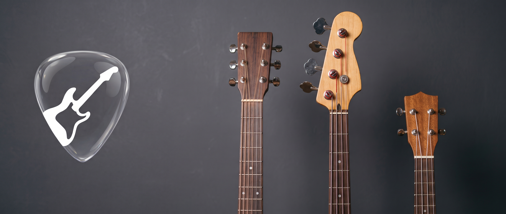
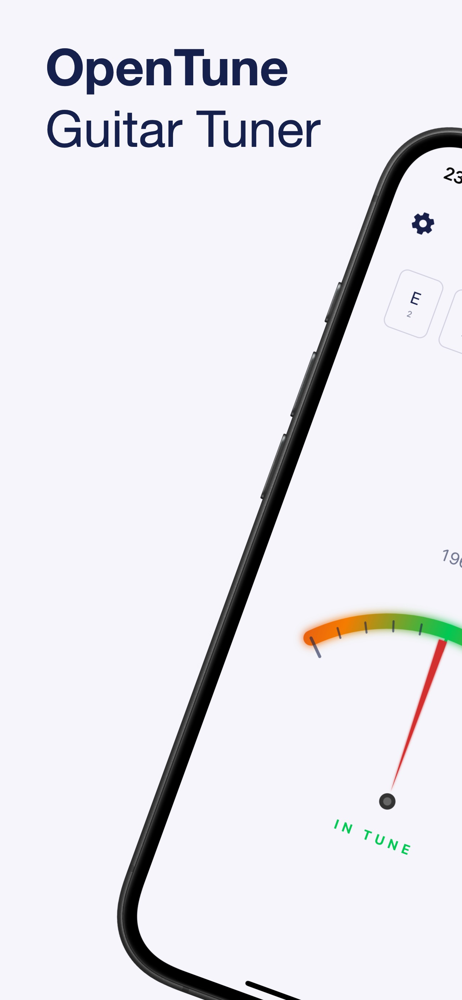
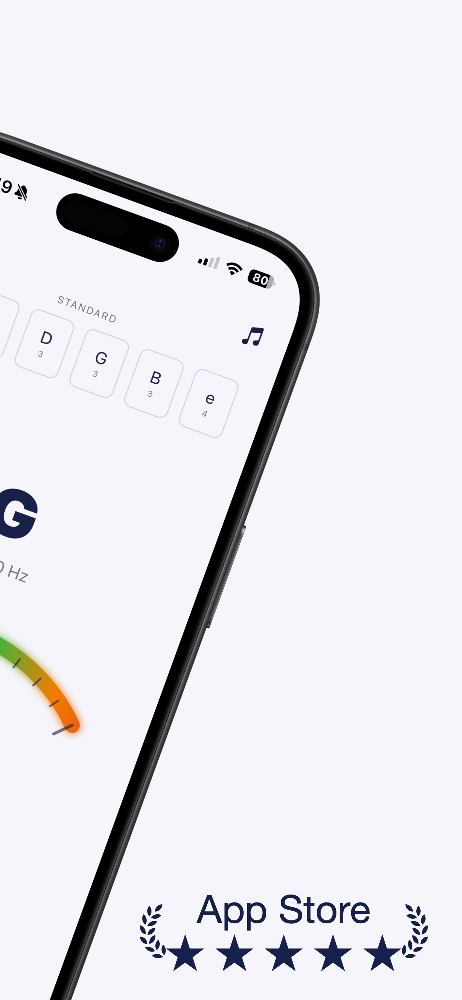
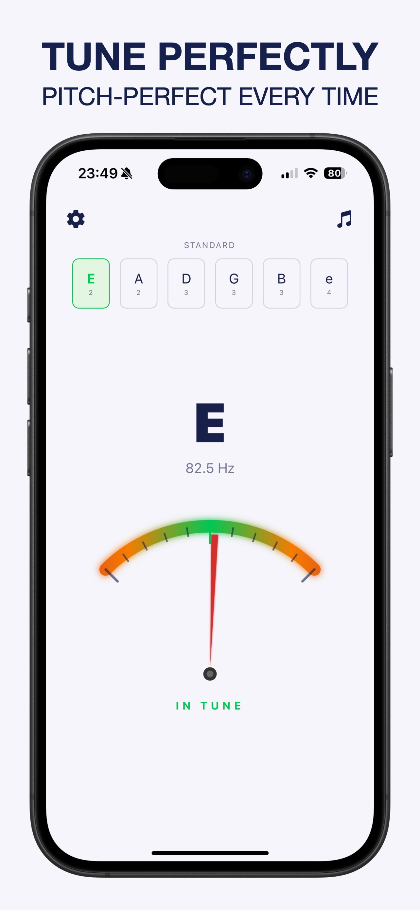
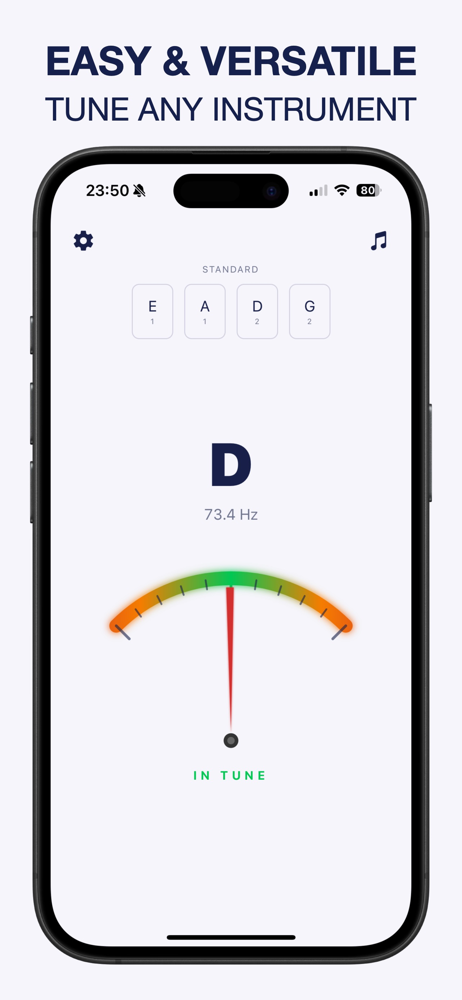

# 🎸 OpenTune — Fast, Accurate & Simple Guitar Tuner

> **No clutter. Just tuning.**  
> Studio-grade pitch detection for Guitar, Bass, Ukulele, Violin, and Mandolin.

## ✨ Key Features

- **Real-Time DSP Pitch Engine**: Instant frequency (Hz) and cent deviation readout calibrated from low `B0` bass strings up to `E5` violin strings.
- **17+ Built-In Tunings Across 4 Instrument Families**:
  - **Guitar (6-String)**: Standard, Drop D, DADGAD, Half-Step Down, Full-Step Down (D), Drop C, Open G, Open D, Open E
  - **Bass (4 & 5-String)**: 4-String Standard, Drop D, Drop C, 5-String Standard
  - **Ukulele**: Standard (High G), Low G, D Tuning
  - **Violin & Mandolin**: Standard Fifths (`G3 D4 A4 E5`)
- **Auto & Manual String Lock**: Automatic target recognition or single-tap manual string locking.
- **Stage-Ready Themes**: High-contrast Dark Mode and clean Light Mode with automatic screen wake-lock while tuning.

## 📱 Screenshots

  
  
  
  

## ⚖️ Legal & Support

- [Landing Page](index.html)
- [Privacy Policy](privacy-policy.html)
- [Terms & Conditions](terms-and-conditions.html)
- **Contact**: [sevinc.aeren@gmail.com](mailto:sevinc.aeren@gmail.com)
